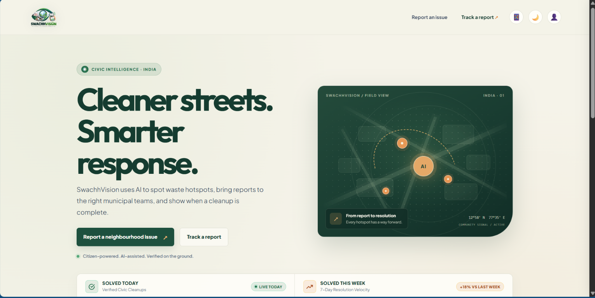

# 🌿 SwachhVision — AI Garbage Hotspot Detection & Civic Intelligence System

[](https://www.python.org/)
[](https://fastapi.tiangolo.com/)
[](https://opencv.org/)
[](https://ultralytics.com/)
[](LICENSE)

An automated civic intelligence platform designed for municipal corporations and nationwide civic administration. **SwachhVision** combines computer vision, spatial density clustering, and closed-loop field resolution to detect street waste accumulation, identify chronic hotspots, and guarantee verified resolution proof.

---

## ✨ SwachhVision Interface

<p align="center">
  
</p>

---

## 🌟 Key Capabilities

1. **Dual AI Visual Assessment**:
   - Analyzes citizen hazard photos using YOLOv8 segmentation and OpenCV spatial pixel coverage.
   - Accurately classifies waste categories (Biodegradable, Non-Biodegradable Plastic, Hazardous, Construction Debris).
2. **Context-Aware Severity Scoring**:
   - Dynamically weights waste extent score (1–5) against proximity to sensitive points of interest (Schools, Hospitals, Water Bodies, Bus Stations) via OpenStreetMap reverse geocoding.
3. **DBSCAN Spatial Hotspot Clustering**:
   - Clusters recurring neighborhood complaints within defined geofenced radiuses to detect chronic unserviced dumping hotspots.
4. **Automated Departmental Routing**:
   - Intelligently dispatches tickets to Solid Waste Management, Sewerage Board, or Public Health squads.
5. **Closed-Loop AI Verification Proof**:
   - Field workers submit after-cleanup photos. AI validates residual waste (<5%) before granting an official **AI Verified Resolution Certificate**.

---

## 🏛️ Integrated Portals

| Portal | Route | Description |
| :--- | :--- | :--- |
| **Citizen Portal** | `/` or `/citizen` | Clean reporting workflow with auto-GPS, live complaints drawer, and dark/light themes. |
| **Admin Operations** | `/admin` | Interactive Leaflet heatmaps, chronic hotspot clusters, and live incident feed. |
| **Worker Portal** | `/worker` | Assigned task queue, navigation routing, and after-cleanup photo submission. |
| **Verification Tracker** | `/tracker` | Public transparency portal displaying before-and-after photo comparison and verified seal. |
| **API Docs (Swagger)**| `/docs` | Interactive OpenAPI documentation for all REST endpoints. |

---

## 🚀 Quickstart Guide

### Prerequisites
- Python 3.10+
- Node.js 20.19+ (or 22.12+) and npm for the React frontend
- (Optional) PostgreSQL with PostGIS extension (system automatically falls back to SQLite `civicai.db` if PostgreSQL is not running).

### 1. Clone & Set Up Backend
```bash
# Navigate to the backend directory
cd backend

# Create and activate Python virtual environment
python -m venv venv
source venv/bin/activate       # On Linux/macOS
.\venv\Scripts\activate        # On Windows (PowerShell)

# Install dependencies
pip install -r requirements.txt
```

### 2. Start the Server
```bash
uvicorn app.main:app --reload --host 127.0.0.1 --port 8000
```
Open [http://127.0.0.1:8000](http://127.0.0.1:8000) in your browser to access the backend and API documentation.

### 3. Start the React Frontend (Development)
In a separate terminal:
```bash
cd frontend
npm install
npm run dev
```
Open the Vite URL shown in the terminal (normally [http://127.0.0.1:5173](http://127.0.0.1:5173)). The development server proxies API and upload requests to FastAPI.

For production, run `npm run build` in `frontend` before starting FastAPI. The backend will serve the React build on the portal routes.

### 4. (Optional) Seed Demo Data
To populate realistic civic incidents across Bengaluru/Delhi/Mumbai for demonstration:
```bash
python -m app.db.seed_demo_data
```

### 5. Run Automated Test Suite
```bash
python -m unittest discover -s tests
```

---

## 📁 Repository Structure

```text
├── backend/
│   ├── app/
│   │   ├── api/v1/          # REST Endpoints (Incidents, Hotspots, Departments, Analytics)
│   │   ├── core/            # Database config & settings
│   │   ├── db/              # Seed scripts & DB initializers
│   │   ├── models/          # SQLAlchemy ORM Models (Incident, Hotspot, Department)
│   │   ├── schemas/         # Pydantic validation schemas
│   │   └── services/        # AI CV Service, Geo Routing, DBSCAN Hotspot engine
│   ├── tests/               # 27 Comprehensive Unit & E2E Tests
│   ├── requirements.txt     # Python backend dependencies
│   └── uploads/             # Media upload storage
├── frontend/
│   ├── react-app/src/       # React rendering and portal routing
│   ├── index.html, admin.html, worker.html, tracker.html  # Existing portal layout and behavior sources
│   ├── package.json         # React and Vite dependencies
│   ├── vite.config.js       # Development proxy and production build
│   └── dist/                # Generated production frontend
├── docs/                    # Pitch guide, execution logs & architecture diagrams
└── README.md                # Project documentation
```

---

## 🛡️ License
Distributed under the MIT License. See `LICENSE` for more information.
